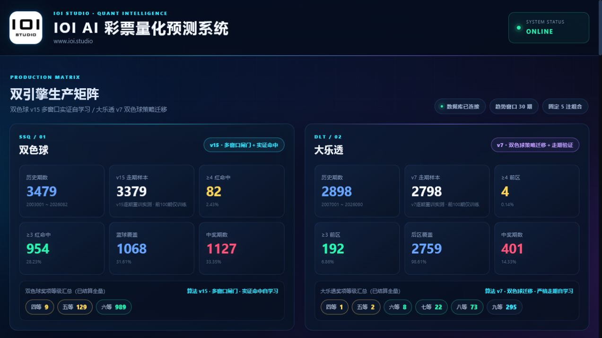
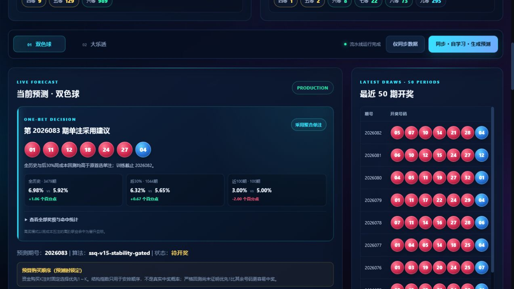
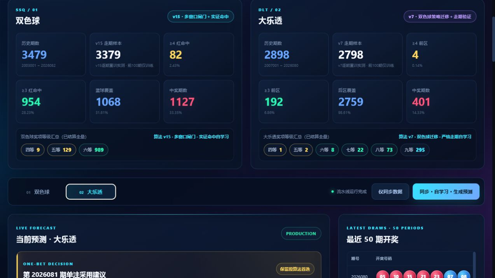

<div align="center">
  
  <h1>IOI-LottoLab</h1>
  <p><strong>可审计、可回放、可复现的双色球 / 大乐透量化研究平台</strong></p>
  <p>
    把历史数据、组合优化、严格走期回测和开奖后审计放进同一个专业仪表盘。
  </p>
  <p>
    <a href="README_EN.md">English</a> ·
    <a href="#-快速开始">快速开始</a> ·
    <a href="#-算法全景">算法全景</a> ·
    <a href="#-历史回测快照">历史战绩</a> ·
    <a href="#-客观评价">客观评价</a>
  </p>
  <p>
    
    
    
    
    
    <a href="https://github.com/ioi-studio/IOI-LottoLab/stargazers"></a>
  </p>
</div>


> [!IMPORTANT]
> 彩票开奖具有强随机性。本项目不承诺预测未来，不构成购彩或投资建议。它的价值在于把每次候选生成、回测和结算做成可追踪的量化研究流程。

## ✨ 为什么是 IOI-LottoLab

很多彩票项目只给出一组号码；IOI-LottoLab 更关心这组号码是**何时生成、用了哪些历史、如何冻结、开奖后怎样结算，以及是否真的优于公平基线**。

- **严格走期（walk-forward）**：预测目标期只允许读取此前开奖，杜绝把未来数据混入训练。
- **预测审计台账**：候选号码、算法版本和模型信息在开奖前锁定，开奖后按原记录结算。
- **双层稳定性闸门**：最近 50 期负责发现变化，最近 200 期负责阻止短窗口偶然胜出就切换生产策略。
- **双彩种生产矩阵**：内置双色球 `v15` 与大乐透 `v7`，统一展示数据、候选、回测、奖级和诊断。
- **组合级优化**：不是简单挑“热号”，而是在固定预算下同时优化覆盖、重叠、结构、红蓝同注关系和优先顺序。
- **诚实的统计结论**：同时报告公平开奖精确值、置信区间、p 值、Brier Score 和失败的实验，不把结构指数伪装成中奖概率。
- **一套代码，多种入口**：Web 仪表盘、Windows 桌面壳、命令行预测、研究脚本与自动化回测。

## 🖥️ 产品预览

### 双引擎生产矩阵



### 实时候选与同成本回测



### 大乐透组合与购买优先级



## 📊 历史回测快照

以下数据生成于 **2026-07-20**。统一口径为：前 100 期仅作学习样本，之后每期固定 5 注；目标期本身不会进入当期训练。完整原始报告见 [生产算法全历史回测](production_backtest_report.md)。

| 彩种 | 当前生产算法 | 严格走期样本 | ≥4 前区/红球 | ≥3 前区/红球 | 后区/蓝球覆盖 | 中奖期数 |
|---|---|---:|---:|---:|---:|---:|
| 双色球 | `ssq-v15-stability-gated` | 3,379 | 82（2.43%） | 954（28.23%） | 1,068（31.61%） | 1,127（33.35%） |
| 大乐透 | `dlt-v7-transfer-coverage` | 2,798 | 4（0.14%） | 192（6.86%） | 2,759（98.61%） | 401（14.33%） |

回测中的每期最佳奖级分布：

| 彩种 | 四等奖 | 五等奖 | 六等奖 | 七等奖 | 八等奖 | 九等奖 |
|---|---:|---:|---:|---:|---:|---:|
| 双色球 | 9 | 129 | 989 | — | — | — |
| 大乐透 | 1 | 2 | 8 | 22 | 73 | 295 |

### 同成本单注压缩

系统还能把生产模型的 5 注候选在线压缩为 1 注，并与“原算法首选单注”进行同成本比较。

| 彩种 | 区间 | 聚合单注中奖率 | 原首选单注 | 绝对变化 |
|---|---|---:|---:|---:|
| 双色球 | 全历史 3,479 期 | 6.98% | 5.92% | +1.06 个百分点 |
| 双色球 | 近 100 期 | 3.00% | 5.00% | -2.00 个百分点 |
| 大乐透 | 全历史 2,898 期 | 6.76% | 6.25% | +0.52 个百分点 |
| 大乐透 | 近 100 期 | 6.00% | 9.00% | -3.00 个百分点 |

近期窗口并未保持全历史优势，这正是项目保留滚动窗口、稳定性闸门和失败报告的原因。完整数据见 [双色球单注报告](reports/single_ticket_backtest_ssq.md) 与 [大乐透单注报告](reports/single_ticket_backtest_dlt.md)。

### 开奖前锁定记录

双色球第 `2026082` 期，开奖前锁定的 `v13` 五注中有一注命中 4 个红球，获得五等奖 10 元；五注总投入 10 元，本期净额为 0 元。`v15` 是开奖后才升级的版本，因此项目没有把这次记录冒充为 `v15` 的事前成绩。详见 [完整复盘](reports/2026082_v15_v7_upgrade_report.md)。

## 🧠 算法全景

算法按“生产、候选、验证、研究”分层管理。没有通过统计闸门的模型会被保留为研究候选，而不会自动进入生产预测。

### 1. 当前生产算法

| 模块 | 算法 | 作用 |
|---|---|---|
| 双色球 | `ssq-v15-stability-gated` | 50/200 期多窗口闸门、稳定覆盖基线、历史极端形态硬过滤、候选组合排序 |
| 大乐透 | `dlt-v7-transfer-coverage` | 双色球覆盖策略迁移、前后区低重叠覆盖、12 组候选走期晋升 |
| 组合基线 | `v8-balanced` | 确定性随机种子、固定预算下的前后区覆盖与组合重叠控制 |
| 单注聚合 | Online Logistic Ensemble | 将 5 注来源组合在线压缩为 1 注；每期开奖后才更新权重 |
| 购买顺序 | Walk-forward Priority Ranking | 用近期结构拟合与小比例频率项安排优先级；明确标记为“指数”，不是概率 |
| 参数选择 | Adaptive Optimizer | 比较覆盖与高奖重叠候选，并要求近期窗口和稳定窗口同时守住关键指标 |

### 2. 量化候选模型

- 贝叶斯频率收缩（Bayesian Frequency Shrinkage）
- EWMA 热度：半衰期 10 / 25 / 50
- EWMA 25 期均值回归
- EWMA 10/80 短长周期交叉
- Markov 命中状态转移
- 遗漏间隔均值回归（Gap Reversion）
- 历史频率软混合
- 红蓝共现矩阵与最优分配
- 大乐透后区配对频率与低重叠选择
- 位置频率、节奏检测、邻号吸引、趋势动量与蓝球共识投票

### 3. 结构特征与过滤

- 和值、跨度、AC 值
- 奇偶比、大小比、质合比
- 三区分布、012 路分布、尾数集中度
- 连号、重号、邻号、遗漏与平均间隔
- 历史完整组合去重、历史零出现极端结构过滤
- 组合覆盖率、任意两注最大重叠、前后区同注对齐

### 4. 统计验证

- 严格逐期走期与留出验证
- Brier Score 与等概率基线
- Newey–West 自相关稳健检验
- Bonferroni 多重检验校正
- 四时间块稳定性门槛
- 配对区块 Bootstrap 与 95% 置信区间
- McNemar 配对检验
- Wilson 区间
- 精确组合概率与 Monte Carlo 隔离模拟

### 5. 独立研究模块

- 卡方均匀性检验、K-S 检验、游程检验
- 自相关、趋势与时间序列诊断
- FFT 频谱与周期检测
- Markov 转移矩阵
- 信息熵、关联规则和频繁号码对/三元组
- 本福特定律与衍生指标分布
- 销量/奖池相关性分析
- 天气、季节、农历与五行等外生变量探索

> 外生变量和频谱等模块属于探索性研究，不是默认生产信号。相关性不等于因果性。

## 🔬 客观评价

IOI-LottoLab 当前最可靠的能力是**研究流程、组合覆盖和审计复现**，而不是已经证实的彩票可预测性。

在最近 500 期隔离验证中：

| 彩种 | 当前算法任意奖 | 公平开奖精确值 | 配对检验 |
|---|---:|---:|---:|
| 双色球 | 32.80% | 32.93% | `p = 0.6203` |
| 大乐透 | 32.40% | 32.28% | `p = 0.6898` |

红球/前区与蓝球/后区的最新量化候选均未通过门控，多重校正后 `p = 1.0000`，系统因此回退到等概率或覆盖型生产逻辑。完整方法与结果见 [v8 隔离验证报告](validation_report_v8.md)。

客观结论：

- 历史回测能衡量流程和组合结构，但不能证明下一期存在同等优势。
- 5 注覆盖的确定性优势来自组合几何，而不是发现了开奖规律。
- 头奖事件极稀少，几百甚至几千期样本仍不足以用头奖次数可靠地区分算法。
- 当前优先级排序没有通过单调性和统计显著性验收，因此不能解释为真实中奖概率。

这份“敢于展示失败结果”的透明度，是项目最重要的设计原则之一。

## 🚀 快速开始

### Windows 免安装版

仓库已经附带可执行程序，不配置 Python 也能直接体验：

- [推荐：下载 Windows 当前版](https://github.com/ioi-studio/IOI-LottoLab/releases/download/v1.0.0/IOI-LottoLab-Windows.exe)
- [统计修复兼容版本](https://github.com/ioi-studio/IOI-LottoLab/releases/download/v1.0.0/IOI-LottoLab-Windows-StatsFix.exe)
- 仓库完整快照同时保留[当前版](<IOI AI 彩票量化预测系统.exe>)与[统计修复版](<IOI AI 彩票量化预测系统-统计修复版.exe>)。

双击后会启动本地服务并打开专业仪表盘。历史开奖、预测审计和模型状态数据库也已随仓库提供。

### Web 仪表盘

```bash
git clone https://github.com/ioi-studio/IOI-LottoLab.git
cd IOI-LottoLab

python -m venv .venv
```

Windows：

```powershell
.\.venv\Scripts\Activate.ps1
python -m pip install -r requirements.txt
python web_app.py
```

macOS / Linux：

```bash
source .venv/bin/activate
python -m pip install -r requirements.txt
python web_app.py
```

浏览器打开：`http://127.0.0.1:5000`

首次运行时，本地数据库为空，可先同步历史数据：

```bash
python sync_history.py --help
python sync_history.py --game all
```

Windows 用户也可以双击 `彩票预测平台.bat` 启动。

### 常用命令

```bash
# 双色球 / 大乐透命令行预测
python ssq_predict.py
python dlt_predict.py

# 严格隔离回测
python rigorous_backtest_v8.py

# 单注在线聚合回测
python single_ticket_ensemble.py --help

# 单元测试
python -m unittest discover -p "test_*.py"
```

## 🗂️ 项目结构

```text
IOI-LottoLab/
├── web_app.py                    # Flask 仪表盘与 API
├── templates/ + static/         # 专业量化仪表盘
├── ssq_adaptive_predictor.py     # 双色球 v15
├── dlt_adaptive_predictor.py     # 大乐透 v7
├── single_ticket_ensemble.py     # 五注到单注在线聚合
├── auto_optimizer.py             # 多窗口参数晋升
├── quant_models.py               # 量化候选与统计门控
├── ticket_ranking.py             # 走期优先级排序
├── *_prediction_audit.py         # 开奖前锁定与开奖后结算
├── backtest*.py                  # 多套严格回测
├── reports/                      # 可复核报告
├── charts/                       # 研究图表
└── tests                         # unittest 测试脚本
```

## 🛡️ 数据与隐私

- 仓库直接包含历史开奖库、预测审计库、模型状态和 Windows 可执行程序，克隆后即可查看当前完整快照。
- 这些 SQLite 文件只包含项目的彩票历史、研究结果与预测审计数据，不包含用户账号体系。
- `tmp/` 浏览器资料、编译中间目录、重复构建副本和运行日志不会提交。
- 后续在本地生成的新预测会继续写入同一套 SQLite 数据库；提交个人分支前请自行检查变更。
- 数据同步依赖公开开奖数据源；使用前请自行核对数据完整性和当地规则。

## 🤝 参与贡献

欢迎提交 Issue、复现实验或 Pull Request，尤其期待：

- 新的数据源与完整性校验
- 更严格的样本外评估
- 可复现的公平基线
- Linux / macOS 启动体验
- Docker、CI 与可下载 Release
- 可访问性、移动端和国际化改进

详见 [贡献指南](CONTRIBUTING.md)。

## ⭐ 支持项目

如果你认同“**用审计和统计约束彩票研究，而不是用夸张承诺包装随机性**”，欢迎给项目一个 Star。它会帮助更多对量化、回测和数据可视化感兴趣的人看到这个项目。

## 📄 许可证

[MIT License](LICENSE) © 2026 IOI Studio

## ⚠️ 免责声明

本项目仅用于软件工程、概率统计、数据分析和可视化研究。任何历史命中、回测指标或候选号码都不代表未来收益，不应被视为投注建议。请遵守当地法律法规，理性参与，量力而行。
