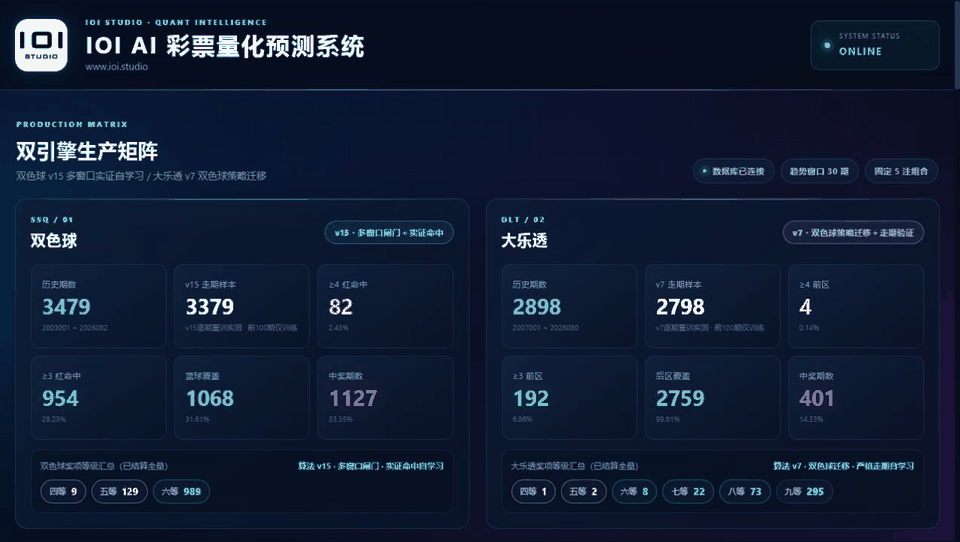

<div align="center">
  
  <h1>IOI-LottoLab</h1>
  <p><strong>An auditable, replayable and reproducible quantitative lottery research platform.</strong></p>
  <p>SSQ and DLT analytics, walk-forward backtests, portfolio construction, prediction locking and post-draw settlement in one dashboard.</p>
  <p><a href="README.md">简体中文</a></p>
  <p>
    
    
    
    <a href="https://github.com/ioi-studio/IOI-LottoLab/stargazers"></a>
  </p>
</div>



> [!IMPORTANT]
> Lottery draws are highly random. This project does not promise future results and is not betting or investment advice.

## Why this project is different

- **Leakage-resistant walk-forward evaluation**: each target draw is excluded from its own training data.
- **Pre-draw audit ledger**: tickets, algorithm versions and metadata are locked before settlement.
- **50/200-draw stability gate**: a short window detects change; a longer window prevents accidental short-term wins from replacing production.
- **SSQ + DLT production matrix** with predictions, draw history, prize levels, diagnostics and learning status.
- **Budget-aware portfolio construction** for coverage, overlap, structural fit and red/blue alignment.
- **Honest statistics**: fair-draw exact values, Brier scores, confidence intervals, p-values and failed experiments are reported.
- **Web, desktop and CLI entry points** backed by the same research pipeline.

## Backtest snapshot

Snapshot date: **2026-07-20**. The first 100 draws are warm-up data; every later target uses only prior history and a fixed five-ticket budget.

| Game | Production algorithm | Walk-forward draws | ≥4 main-zone hits | ≥3 main-zone hits | Secondary-zone coverage | Winning draws |
|---|---|---:|---:|---:|---:|---:|
| SSQ | `ssq-v15-stability-gated` | 3,379 | 82 (2.43%) | 954 (28.23%) | 1,068 (31.61%) | 1,127 (33.35%) |
| DLT | `dlt-v7-transfer-coverage` | 2,798 | 4 (0.14%) | 192 (6.86%) | 2,759 (98.61%) | 401 (14.33%) |

These are historical walk-forward replays, not pre-registered live results. See the [full production report](production_backtest_report.md).

## Objective verdict

The strongest verified capability is the **research, portfolio and audit workflow**, not proven predictability.

| Game | Observed any-prize rate | Fair-draw exact value | Paired test |
|---|---:|---:|---:|
| SSQ | 32.80% | 32.93% | `p = 0.6203` |
| DLT | 32.40% | 32.28% | `p = 0.6898` |

The latest main-zone and secondary-zone quantitative candidates did not pass the deployment gate (`Bonferroni-adjusted p = 1.0000`). The system therefore falls back to uniform or coverage-oriented production logic. Read the [isolated validation report](validation_report_v8.md) for the full methodology.

## Algorithm map

### Production

- SSQ v15 multi-window stability-gated coverage
- DLT v7 transfer coverage
- Deterministic V8 balanced portfolio baseline
- Online logistic five-to-one ticket ensemble
- Walk-forward structural priority ranking
- Adaptive 50/200-window configuration promotion

### Quantitative candidates

- Bayesian frequency shrinkage
- EWMA hot signals with half-lives 10, 25 and 50
- EWMA mean reversion and 10/80 crossover
- Markov hit-state transitions
- Gap reversion
- Historical-frequency soft blending
- Red/blue co-occurrence assignment
- DLT secondary-zone pair weighting
- Position frequency, rhythm, neighbor attraction and trend momentum

### Validation

- Brier score versus a uniform baseline
- Newey–West robust inference
- Bonferroni multiple-testing correction
- Four-block temporal stability
- Paired block bootstrap and 95% confidence intervals
- McNemar tests, Wilson intervals, exact combinatorics and Monte Carlo isolation

### Independent research

- Chi-square, K-S and runs tests
- Autocorrelation and time-series diagnostics
- FFT spectral analysis
- Markov transition matrices
- Information entropy and association-rule mining
- Weather, season and lunar-calendar exploratory analysis

Exploratory modules are not enabled as default production signals. Correlation is not causation.

## Quick start

### Windows without Python

The repository includes ready-to-run binaries:

- [Recommended: current Windows build](https://github.com/ioi-studio/IOI-LottoLab/releases/download/v1.0.0/IOI-LottoLab-Windows.exe)
- [Statistics-fix compatibility build](https://github.com/ioi-studio/IOI-LottoLab/releases/download/v1.0.0/IOI-LottoLab-Windows-StatsFix.exe)
- The full repository snapshot also retains the [current build](<IOI AI 彩票量化预测系统.exe>) and [statistics-fix build](<IOI AI 彩票量化预测系统-统计修复版.exe>).

The bundled lottery history, prediction audits and model-state snapshots let
the dashboard open with the current research state immediately.

### Run from source

```bash
git clone https://github.com/ioi-studio/IOI-LottoLab.git
cd IOI-LottoLab
python -m venv .venv
```

Windows:

```powershell
.\.venv\Scripts\Activate.ps1
python -m pip install -r requirements.txt
python web_app.py
```

macOS / Linux:

```bash
source .venv/bin/activate
python -m pip install -r requirements.txt
python web_app.py
```

Open `http://127.0.0.1:5000`.

The repository includes the current lottery-history databases, prediction
audit ledgers, model states and Windows executables so the dashboard can be
explored immediately after cloning. Browser profiles, build intermediates,
duplicate distribution copies and runtime logs remain excluded.

## Contributing

Reproducible experiments, independent baselines, data-source validation, portability improvements and UI work are welcome. See [CONTRIBUTING.md](CONTRIBUTING.md).

## License and disclaimer

[MIT License](LICENSE) © 2026 IOI Studio.

For research and educational use only. Historical hits, backtests and generated tickets do not imply future returns.
